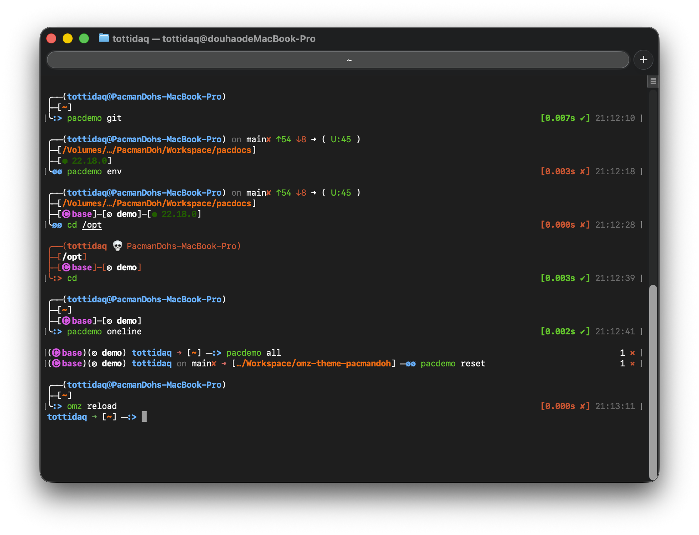

# PacmanDoh Terminal

**Kali-inspired Zsh terminal for macOS and Linux — one command to bootstrap Oh My Zsh, plugins, and a fast prompt.**

## Quick install

### China (Gitee, recommended)

```sh
curl -fsSL https://gitee.com/pacmandoh/omz-theme-pacmandoh/raw/main/install.sh | bash
```

Non-interactive:

```sh
curl -fsSL https://gitee.com/pacmandoh/omz-theme-pacmandoh/raw/main/install.sh | bash -s -- --yes --full
```

### GitHub

```sh
curl -fsSL https://raw.githubusercontent.com/pacmandoh/omz-theme-pacmandoh/main/install.sh | bash
```

```sh
curl -fsSL https://raw.githubusercontent.com/pacmandoh/omz-theme-pacmandoh/main/install.sh | bash -s -- --yes --full
```

### Local checkout

```sh
./install.sh
./install.sh --yes --minimal
./install.sh --dry-run --yes --full
```

## Update

```sh
./install.sh --update
curl -fsSL https://gitee.com/pacmandoh/omz-theme-pacmandoh/raw/main/install.sh | bash -s -- --update
```

Refreshes the theme file and pulls third-party plugin repos. Oh My Zsh itself updates via `omz update` in zsh.

Update specific plugins only:

```sh
./install.sh --update --plugins=zsh-autosuggestions,zsh-syntax-highlighting
```

## Preview



## What you get

- **Kali-style prompt** — rounded box layout (multiline) or compact single line (oneline), git branch with ahead/behind (`↑`/`↓`), permission-aware colors
- **Environment line** — multiline shows `🅒 conda` / `◎ venv` / `⬢ node` on its own row when active; oneline prefixes `()` with the same icons
- **One installer** — Oh My Zsh, theme, plugins, `.zshrc` tuning
- **Mirror-friendly** — auto-detect CERNET / TUNA / GitHub for Oh My Zsh; Gitee mirrors for plugins in China
- **Fast startup** — optional lazy-load for conda and nvm
- **Prompt performance** — git status cache, permission-aware colors

Oneline git shows branch, clean/dirty (`✔`/`✘`), and ahead/behind — not per-file counts.

## Install profiles

| Profile | Command | Installs |
|---------|---------|----------|
| Interactive | `./install.sh` | Guided menus |
| Default | `--yes` | OMZ (if missing), theme, autosuggestions + syntax-highlighting, lazy loaders |
| Minimal | `--yes --minimal` | OMZ (if missing) + theme only |
| Full | `--yes --full` | Default + conda-zsh-completion |

More flags: `./install.sh --help`

Common options: `--no-omz`, `--no-lazy`, `--prompt=multiline|oneline`, `-n` / `--dry-run`, `-v` / `--verbose`.

## Plugins

Third-party plugins clone from Gitee or GitHub mirrors. Built-in Oh My Zsh plugins are added to `plugins=(...)` in `.zshrc` only.

### Third-party (git clone)

| Plugin | Source |
|--------|--------|
| zsh-autosuggestions | zsh-users / Gitee mirror |
| zsh-syntax-highlighting | zsh-users / Gitee mirror |
| conda-zsh-completion | conda-incubator / Gitee mirror |

### Built-in (`.zshrc` only)

| Plugin | Notes |
|--------|-------|
| extract | `x` extracts archives |
| gitignore | `gi` generates .gitignore |
| sudo | double-ESC to prefix `sudo` |
| z | smart directory jump (no extra install) |
| colored-man-pages | colorized `man` output |
| copypath / copyfile | copy path or file to clipboard |
| dirhistory | Alt+←/→ directory navigation |
| docker / docker-compose | Docker aliases and completion |
| kubectl | Kubernetes helpers |
| python / pip / virtualenv | Python development |
| golang / rust / npm | language tooling |
| terraform / aws / vscode | infra, cloud, editor |
| autojump | needs `autojump` installed separately |
| ssh-agent | ssh-agent integration |
| macos / brew | macOS only |
| command-not-found / systemd | Linux only |

Examples:

```sh
./install.sh --yes --plugins=zsh-autosuggestions,extract,z,docker
./install.sh --yes --plugins=extract,gitignore,z,colored-man-pages   # built-in only
```

## Manual theme install

Copy `pacmandoh.zsh-theme` to `~/.oh-my-zsh/custom/themes/` and set:

```sh
ZSH_THEME="pacmandoh"
```

## Configuration

In `~/.zshrc`:

| Variable | Values | Default |
|----------|--------|---------|
| `PACMANDOH_PROMPT_ALTERNATIVE` | `multiline`, `oneline` | `multiline` |
| `PACMANDOH_NEED_TIMER` | `yes`, `no` | `yes` |
| `PACMANDOH_NEWLINE_BEFORE_PROMPT` | `yes`, `no` | `yes` |

In `oneline` mode, timer and newline default to `no`.

**Permissions**: root on Linux; directory owner on macOS.

## Project layout

```text
install.sh              # entry point
pacmandoh.zsh-theme     # Oh My Zsh theme
scripts/
  main.sh               # install flows
  lib/                  # omz, plugins, zshrc, ui
```

## Listed in

[`awesome-zsh-plugins`](https://github.com/unixorn/awesome-zsh-plugins)

## License

[MIT](./LICENSE)
